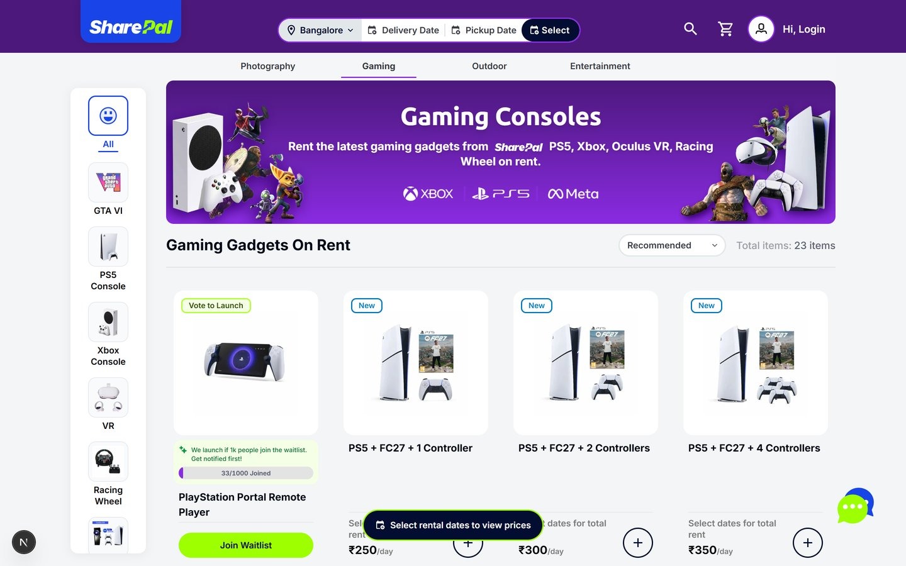
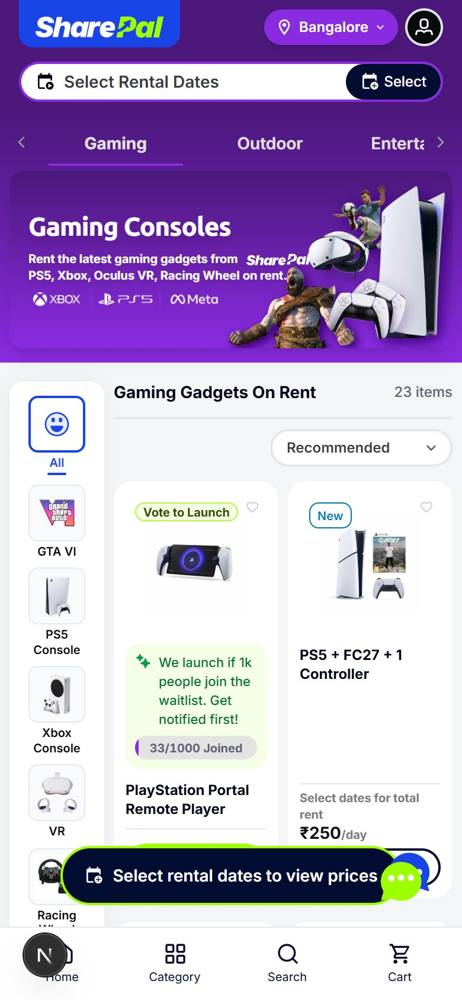
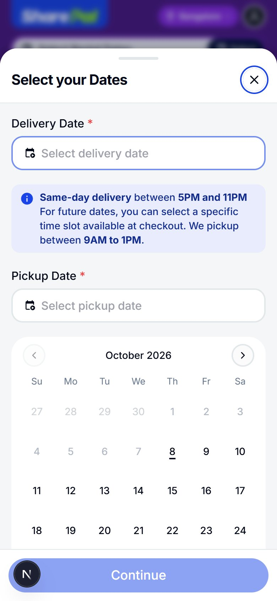
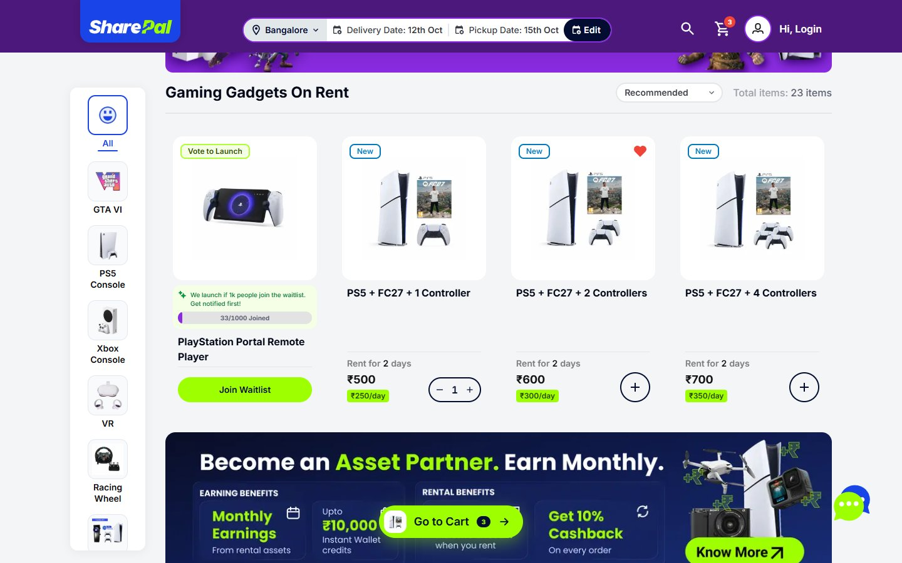

# SharePal: Gaming Gadgets on Rent (recreation)

A recreation of SharePal's [Bangalore gaming rentals page](https://sharepal.in/bangalore/gaming-gadgets-on-rent), built for the SharePal internship assignment. It copies the layout, sections, type scale, colours, spacing, images, buttons, interactions and animations, and the product grid is driven by the supplied `product-list.json`.

**Live:** https://sharepal-gaming-rentals-one.vercel.app · **Stack:** Next.js 15 (App Router) · React 19 · TypeScript (strict) · Tailwind CSS 3 · Radix UI (Dialog, Accordion) · Sonner



## How it was matched

Rather than eyeballing screenshots, I measured the live page:

- **Design tokens.** SharePal's compiled stylesheet was parsed for its custom type scale (`text-sh5`, `text-b4`, `text-h6`, …), colour ramps (`primary-900`, `secondary-500`, `neutral-150`, …), the 1216px container, and the marquee and accordion keyframes. They live in [`tailwind.config.ts`](tailwind.config.ts) under the same names, so class names mean exactly what they mean on sharepal.in.
- **Layout.** A headless-Chrome DOM dump of the live page at 1440px and 390px gave every element's box, font, colour, radius, shadow and transition. Components reuse those values.
- **Artwork.** Logos and icons are SharePal's own SVGs, converted to typed React components ([`src/components/icons.tsx`](src/components/icons.tsx)). Banners and product images load from `images.sharepal.in` via `next/image`.
- **Behaviour.** Each live interaction was scripted and recorded (date picking, add to cart, Show More, FAQ drawer, city picker, search, header on scroll), then rebuilt and re-tested against the same script.

## What's on the page

| Section | Behaviour |
| --- | --- |
| Header | City picker, delivery/pickup summary, search, cart badge, login. Slides away while you scroll down and returns when you scroll up (same as live). Separate compact header on mobile. |
| Date picker | Opens on first visit, like the live page. Two-month range calendar on desktop, bottom sheet on mobile. Delivery and pickup days are free, so 12 → 15 Oct bills **2 days (13th–14th)**. |
| Category tabs + sidebar | Sticky; their offsets follow the header. The sidebar filters the grid (All, PS5 Console, Racing Wheel, …) with an empty state for categories that have no products in the feed. |
| Product grid | 4 / 3 / 2 columns. *New*, *Trending* and *Vote to Launch* badges, hover lift, wishlist heart, promo banners after the 4th and 8th product, **Show More** in pages of 12. Default order matches the live page. |
| Prices | Before dates: per-day rent. After dates: total for the chargeable days, plus the per-day rate. `+` becomes a quantity stepper and a green **Go to Cart** pill appears. |
| Vote to Launch | Waitlist progress bar; joining moves it from 33 to 34 of 1000. |
| FAQ | Accordion with the first five questions; **View more FAQ's** opens a drawer with all of them. |
| Reviews | Infinite marquee of Google reviews (60s loop, pauses on hover), then the impact stats with the brand gradient. |
| Footer | Category directory (accordions on mobile), SEO copy with Read More, link columns, contact, socials, Go up. |

<p>
  
  
</p>

## Improvements over the live page

I kept SharePal's design language and changed things that would trip a first-time renter:

1. **Prices before dates.** The live cards blur the price ("₹N/A") until you pick dates. Here every card shows its per-day rent up front (from `per_day_rent`) and switches to the full total once dates are set, so you can compare without committing to dates first.
2. **Add to cart without dates no longer dead-ends.** It opens the date picker and adds the item as soon as you confirm.
3. **Ratings and rental counts** (`rating`, `booked_count`) under each title, so there's social proof on the card itself. Products without ratings don't show a fake 0★.
4. **Out of stock** (`out_of_stock`) is clear: greyed image, an "Out of stock" label, and **Notify me** instead of a dead `+`.
5. **Sorting**: Recommended (live order), Most booked, Price ↑/↓, Top rated. Unavailable items sink to the bottom on every sort except Recommended.
6. **Working search and cart.** Search filters the catalogue as you type. The cart drawer shows line totals for your dates and lets you change quantities.
7. **Remembers you.** City, dates, cart, wishlist and waitlist persist in `localStorage`, and the date picker only auto-opens when no valid dates are saved.
8. **Date picker guard rails.** Past days are disabled. Pickup must leave at least one chargeable day, so days too close to delivery are greyed out. The field you're filling is highlighted, and on mobile the calendar is inline instead of a second tap away.
9. **Accessibility.** Real buttons and headings, labelled icon buttons, `aria-pressed` on toggles, a labelled progress bar, focus rings for keyboard users, and reduced-motion support (the marquee pauses).
10. **Small fixes.** The waitlist counter was white on light grey and is now readable. The live "What is the minimum rental period?" answer had copy pasted from another page ("participation amount of ₹1 lakh"); it now explains the 1-day minimum that follows from SharePal's own billing rule.



## Run it

```bash
npm install
npm run dev        # http://localhost:3010 → redirects to /bangalore/gaming-gadgets-on-rent
npm run build      # production build
npm run lint && npm run typecheck
```

## Project layout

```
src/
  app/                      layout (fonts, metadata, providers) and the page route
  components/               Header, CategoryTabs, Catalog, ProductCard, DateDialog, RangeCalendar,
                            Panels (search, cart, FAQ drawer, city), Faq, Reviews, Footer, FloatingUi
  data/product-list.json    the supplied product feed (23 items)
  data/content.ts           page copy: FAQs, reviews, footer links, categories
  lib/                      products (sorting, live order), rental date maths, store (context + localStorage)
```

## Notes

- Only this page is recreated. Links to other SharePal pages (other categories, policies, banners) go to sharepal.in.
- Login, checkout and the chat assistant show a short notice instead of opening real flows.
- The site sets `noindex`, so the recreation stays out of search results.
